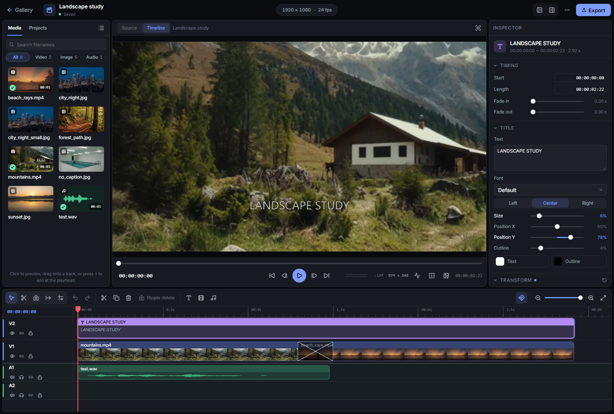

# Video editor

[Documentation](README.md) | [User guide](user-guide.md)

Use the video editor to combine videos, still images, audio, and titles on a multi-track timeline, then export a new MP4. Projects reference the source files in the open folder; editing does not copy or modify those files.

- [Start a project](#start-a-project)
- [Add and replace media](#add-and-replace-media)
- [Edit the timeline](#edit-the-timeline)
- [Adjust picture and titles](#adjust-picture-and-titles)
- [Animate settings](#animate-settings)
- [Mix audio](#mix-audio)
- [Check the preview](#check-the-preview)
- [Save and manage projects](#save-and-manage-projects)
- [Export video](#export-video)
- [Keyboard shortcuts](#keyboard-shortcuts)

## Start a project

1. Open the folder containing your media in the gallery.
2. Choose how to start:
   - In a video's viewer, click the **clapperboard**. The video starts at 00:00 on V1, with its sound linked on A1 when it has audio.
   - In the folder sidebar, choose **Open video editor** to start an empty project. Add a video first to adopt its frame size, frame rate, and name. An empty project starts at 1920 × 1080 and 24 fps.
   - To continue an edit, open it under **Video projects** in the gallery or in the editor's **Projects** tab.
3. Position the timeline playhead where you want to add media. Click a file in **Media** to preview it in **Source**, mark the portion you want with `I` and `O`, then choose **Add to timeline**.
4. Switch the monitor to **Timeline** to play the edit. Select a clip to adjust it in the inspector, or drag its edges to trim it.
5. Check the save status beside the project name, then choose **Export** when ready.

Opening a previously exported video with its project snapshot restores the recorded edit as a new draft; see [Project files](#project-files).

### Find your way around

| Area | Purpose |
| --- | --- |
| Top bar | Rename the project, check save and export status, change project settings, and return to the gallery. The **Project actions** menu contains project management commands. |
| Media browser | Browse the folder's media or switch to **Projects** to reopen a draft. Search filenames, filter by media type, and switch between tiles and a list. Used files are marked. |
| Monitor | **Source** previews a file before you add it; **Timeline** previews the assembled edit. Controls below the monitor play, seek, and step through frames. |
| Timeline | Arrange clips on video and audio tracks. The toolbar contains editing tools, track and title buttons, snapping, and zoom. |
| Inspector | Edit the selected clip, transition, or group of clips. With nothing selected, it shows **Markers** and **Mix**. |

A **source** is a media file; a **clip** uses all or part of that file on the timeline. You can use the same source in several clips with different trims and settings. The **playhead** marks the current playback position.

The top bar can hide the media browser and inspector. Drag the panel dividers to resize them; double-click a divider to reset its size.

### Set the canvas and frame rate

Click the dimensions and frame rate in the top bar, or choose **Project actions > Project settings...**. Enter a width, height, and frame rate, or use **Match a video** to take them from a project source. Odd dimensions round down to even pixels for encoding.

These settings define the canvas and the timeline's frame steps. Export has separate size and shape choices.

## Add and replace media

### Supported sources

Keep the files you want to use in the project's folder.

| Media | Filename suffixes |
| --- | --- |
| Video | `.mp4`, `.mov`, `.m4v` |
| Still image | `.jpg`, `.jpeg`, `.png`, `.webp`, `.bmp` |
| Audio | `.wav`, `.mp3`, `.flac` |

GIF and other gallery video formats are not editor sources. A supported video suffix does not guarantee that the browser can play its codec; see [Preview problems](#preview-problems).

### Preview and place a take

Set the timeline playhead where you want the take to start, then click a file in **Media** to open it in **Source**. For video or audio, seek to the desired start and end and use **Mark in** / **Mark out** or `I` / `O`. Clear the marks to use the whole file again.

- **Add to timeline** places the marked source range at the timeline playhead on the first free compatible track. Existing clips keep their positions.
- The **+** beside a media file adds the whole file at the timeline playhead. Dragging a file from **Media** chooses its track and start time directly: pictures go on video tracks, sound on audio tracks.
- A video with sound also needs a free audio track for its linked audio clip. If there is no room, move the playhead or add a track.
- Stills initially last five seconds. Change **Length** in the inspector or trim their edges to set how long they stay on screen.

While **Source** is active, playback, frame stepping, `Home`, `End`, `I`, and `O` act on the source file. Switch to **Timeline** to use those controls on the edit.

### Insert, replace, or fit to fill

These actions use the file and range currently shown in **Source**.

| Action | Result |
| --- | --- |
| **Insert** | Opens space at the timeline playhead and places the take there. On tracks with sync lock on, clips after the playhead move later and clips crossing it are split. Linked clips follow. A locked track that would change blocks the insert. |
| **Replace** | Replaces one selected media clip while keeping its start, track, link, look, gain, fades, and dissolves. A longer take is cut to the slot; a shorter one ends early and leaves a gap. Replacement is refused if shortening would remove a dissolve. |
| **Fit to fill** | Replaces the selected clip and changes the take's speed to fill its duration exactly. The required speed must be between 0.25× and 4×; mark a range closer to the slot's length if it falls outside that range. |

When replacing a video, a take without sound removes the old linked audio. A take with sound replaces the linked audio or adds it on a free audio track.

## Edit the timeline

### Select, move, split, and delete

Clips stay at their assigned times until you move them or use a ripple operation. Dragging a clip into another stops it flush against that clip; intentional audio overlaps and video dissolves are described below.

- Click a clip to select it. Use `Shift` to add or remove clips, or drag a box over empty lane space to select every clip the box touches. `Shift` adds a box selection to the current selection.
- `Ctrl+A` selects every clip. `A` selects clips starting at or after the playhead; `Shift+A` restricts that selection to tracks containing the currently selected clips.
- Drag a selection to move it, or use `,` / `.` to nudge it one frame earlier / later.
- Choose **Blade** (`B`) and click to split, or press `Ctrl+B` at the playhead. With clips selected, the shortcut splits those clips; with no selection, it splits clips crossing the playhead on unlocked tracks.
- **Delete** removes selected clips and leaves their time empty. **Duplicate** (`Ctrl+D`) places copies after the selection when there is room.
- Use undo and redo to reverse or reapply edits.

A video's linked sound moves, trims, splits, retimes, and deletes with it. Use **Unlink** in the inspector to edit either independently. The inspector also offers **Link video and audio** for a compatible selection.

### Tracks, snapping, and zoom

Higher video tracks cover lower ones. Put titles and overlays above the picture they should cover. Add video or audio tracks from the timeline toolbar.

In a track header, double-click the name to rename it, use the arrows to reorder it, or remove it when empty. **Lock** prevents clip edits; **Hide** removes a video track from the picture; **Mute** silences an audio track; **Solo** isolates audio tracks. Mute takes priority over solo.

**Snapping** (`S`) aligns edits with clip edges, the playhead, and markers. Use `+` / `-` to zoom, `Ctrl` + mouse wheel to zoom around the pointer, or `Shift+Z` to fit the project in view.

Video clips show frame thumbnails; audio clips show a waveform with one lane per channel, left above right. Both update for the visible stretch and zoom level, so zooming in reveals local frames and transients.

### Trim and enter exact times

With **Select** (`V`), drag a clip's start or end edge to trim it. `Q` / `W` trim the start / end to the playhead. Ordinary trims leave other clips in place.

The inspector's **Timing** panel provides exact controls:

| Field | Changes |
| --- | --- |
| **Start** | Where the clip begins on the timeline. |
| **In** | Where playback begins within the source file. This slips the take while the clip stays in place. |
| **Length** | How long the clip lasts on the timeline. |
| **Speed** | Playback rate; linked sound follows and keeps its pitch. |

**Start**, **In**, **Length**, and the transport's playhead time accept `HH:MM:SS:FF` timecode, shorter timecodes such as `SS:FF`, frame counts (`36f`), seconds (`1.5s`), or relative frame changes (`+12`, `-3`). `FF` is the frame field, not a decimal fraction of a second. Values land on the project's frame grid.

### Ripple, roll, and sync lock

Use these tools when a trim should also change the timing of neighboring clips:

- **Ripple trim** (`T`): drag an edge to shorten or extend a clip and move later clips by the same duration change. Trimming the start changes the source in point while the clip's timeline start stays fixed. `Shift+Q` / `Shift+W` ripple trim the start / end of the clip under the playhead to it.
- **Roll trim** (`N`): drag the cut between two touching clips to trim both together. The overall span and every other clip's timing stay fixed. An edge without a touching neighbor trims normally.
- **Ripple delete** (`Shift+Delete`): mark a timeline range with the **Range** tool (`R`), or with `I` and `O`, then remove that interval and close the gap. This differs from deleting selected clips, which leaves a gap.

**Sync lock** is the chain-link button in each track header. Insert, ripple delete, and ripple trims include tracks with sync lock on. Ripple trims also move later clips on the tracks being trimmed. Linked picture and sound stay together even when one track has sync lock off.

A locked track blocks an operation that would change its clips. A ripple trim that would push clips into a new overlap is refused; make room or turn off sync lock on the track you want to leave in place. Ripple and roll trims cannot operate inside a dissolve or crossfade; remove the overlap first.

### Copy clips and attributes

`Ctrl+C` / `Ctrl+X` copy / cut clips with their linked sound and dissolves. `Ctrl+V` pastes them at the playhead, including into another project opened in the same session. Pasting into another folder checks for the referenced files there; missing or changed sources need relinking.

To reuse settings without copying a clip, copy it, select the destination clips, and choose **Paste attributes** (`Ctrl+Shift+V`). Choose which groups to transfer from the first copied clip: color, transform, crop, fades, gain, or title style.

### Markers

In **Timeline** mode, press `M` to add a marker at the playhead for a beat, lyric line, or shot note. Markers appear as flags on the ruler; click one to jump to it, or use `Shift+↑` / `Shift+↓` to step between them. Edits snap to markers when snapping is on.

With nothing selected, the inspector's **Markers** panel lets you name markers, add notes, change their times, search their text, and remove them. Timeline edits never move markers.

## Adjust picture and titles

Select a picture clip to use the inspector:

- **Transform** sets position, scale, rotation, and opacity. **Fit** shows the whole picture within the canvas; **Fill** covers the canvas and can cut off its edges. In the timeline monitor, drag the selected picture to move it or use its corner handles to scale it.
- **Crop** sets the visible source area before fitting and transforming it.
- **Color** provides manual adjustments and **Auto**, which analyzes the clip's frames to correct levels and color cast. Save adjustments as a named grade to reuse in any project.
- **Timing** sets fade in and fade out, as well as clip timing and speed. Double-click a slider's label to reset that setting.

With several clips selected, the inspector can apply fades, gain, fit, scale, opacity, still or title length, or a saved grade to all of them as one undo step.

### Add titles

Move the playhead to the desired start, then choose **Add title** in the timeline toolbar. A title initially lasts three seconds and uses the topmost free video track. Keep it above the underlying picture, and add a video track if there is no room.

Select the title to edit its text, font, size, alignment, position, text color, and outline in the **Title** panel. Set its duration with **Length** or its trim edges. Titles also move, scale, rotate, fade, and animate like other pictures.

Titles can use any font installed on the computer running DataForge. A missing font falls back to the default font.

### Cross-dissolves

Select the outgoing picture clip and add a **cross-dissolve** in the inspector. This moves the next clip back to overlap the selected one; the overlap is the dissolve's duration. Select the transition to change its duration or remove it. Pulling the clips apart also removes the dissolve.

## Animate settings

Position, Scale, Rotation, Opacity, and an audio clip's Gain support keyframes.

1. Select a clip and place the timeline playhead where the animation should begin.
2. Click the **diamond** beside a setting to add a keyframe at that time.
3. Move the playhead and change the setting to create another keyframe. Once a setting has keyframes, its slider and monitor drags change the value at the playhead.
4. Use the arrows beside the setting to step between keyframes. Choose **Linear**, **Ease in**, **Ease out**, **Ease in and out**, or **Hold** to control how the current keyframe leads into the next.

Keyframes appear as diamonds on the clip; gain also appears as an envelope line over the audio waveform. They stay with the picture or sound when the clip is split, trimmed, or retimed.

## Mix audio

Select an audio clip to set its **Gain**, fade lengths, and fade shape. For the overall mix, clear the selection to show the inspector's **Mix** panel.

### Fades and crossfades

Audio clips on the same track may overlap the next clip; the overlap automatically crossfades between them. One clip cannot completely cover another, and at most two clips can overlap on a single audio track.

The **Fades** setting in the clip's **Audio** panel controls fades and crossfades. **Equal power**, the default, keeps crossfade loudness steady; **Linear** dips in the middle.

### Track levels and speech ducking

**Mix** sets the level of each audio track and the **Master** level. Click a track's microphone button to mark it as speech. While one of its clips sounds, other tracks lower to **Duck to**, easing down just before the speech and back up afterward. Ducking follows the speech clips' timing.

During playback, the transport's mix meter shows the preview peak for each channel. It turns amber above -1 dB and latches **Clip** at full scale; click to clear that indicator. Export's **Sound** setting can additionally limit or normalize the finished mix.

## Check the preview

The transport shows the resolution used to draw the monitor. It also reports when color-adjusted clips use a reduced copy or cannot be colored in the browser.

- **Show the export's frame** (image button) renders the playhead frame at full size with the export renderer. Use it to check output fidelity.
- **Scopes** (waveform button) shows a luma waveform, an RGB histogram, and the proportion of the monitor picture crushed to black or clipped to white. Scopes measure the displayed preview.
- **Compare with this frame** (split-square button) holds the current frame as a reference. Move to another shot or adjust this one, then drag the divider to compare the held frame on the left with the live picture on the right.
- **Safe-area guides** overlays guides to help position picture and text.

### Preview problems

If the browser cannot play a source, the monitor names it and explains the problem, such as an unsupported codec. It draws a marked box for that source and lets playback continue.

Use **Retry** to load it again. For a video, **Use an H.264 copy** writes `<stem>-h264.mp4` beside the source and relinks the project to the copy. The original file stays intact.

Missing or changed files need [source recovery](#missing-or-changed-sources) before export.

## Save and manage projects

### Project files

Changes save automatically after editing. New projects are not written until the first edit; the top bar initially shows **Not saved yet: nothing changed**. Use the project name field to rename the edit.

| File | Purpose |
| --- | --- |
| `<stem>-edit.video-project.json` | Editable draft, saved in the project folder. The stem normally comes from the initial video; projects without one use the project name. Taken names get a number. |
| `<export-name>.mp4.video-project.json` | Snapshot beside a whole-timeline export, recording the edit that made it. Opening that video in the editor rebuilds the edit as a new draft. |

For example, `scene.mp4` normally produces the draft `scene-edit.video-project.json` and export `scene-edited.mp4`, with snapshot `scene-edited.mp4.video-project.json`.

Drafts appear under **Video projects** above the gallery's media and in the editor's **Projects** tab. They reference media in their folder, so keep the draft and its sources together when moving or sharing a project.

### Save failures and conflicts

Check the save status beside the name before leaving. **Save failed** offers **Retry**. **Changed in another window** offers **Save as a new draft** to preserve your version separately.

If saving still fails when you try to leave, the editor offers another save attempt, staying in the editor, or exiting and losing changes since the last successful save.

### Versions, duplicates, and deletion

Use **Project actions** for these commands:

- **Versions...** saves a named version or restores an earlier one as a single undoable edit. Saving also keeps automatic checkpoints at ten-minute intervals, retaining the newest 30 in the app's database. Named versions remain until deleted.
- **Duplicate project** saves a copy and continues editing the copy.
- **Delete project...** deletes the draft and closes the editor. Its source media and exported videos remain.

### Missing or changed sources

Files used by the timeline that are missing or have changed in size or modification date appear above the timeline. Nothing is substituted automatically, and export waits until every listed source is resolved.

- **Relink**: choose a replacement of the same media type from the current folder, then click **Relink**.
- **Use the changed file**: accept the current file when its change was intentional.

## Export video

Choose **Export** to render from the source files to a new MP4 in the project folder. The default filename is `<stem>-edited.mp4`. If that name or one of its sidecars is taken, a number is added to avoid overwriting it.

### Choose the output

| Setting | Choices and behavior |
| --- | --- |
| **File name** | Enter the name before the `.mp4` suffix. |
| **Part** | **Whole timeline**, **Marked range**, or **Selected clips** when a range or selection is available. Whole timeline remains the default. |
| **Size** | **Source size** uses the project canvas dimensions as the basis; other presets are **720p** and **1080p**. |
| **Shape** | **Landscape**, **Portrait**, or **Square**. A changed output frame fits the composition without stretching it. |
| **Quality** | **Standard**, **High quality**, or **Smaller file**. The summary shows dimensions, frame rate, duration, and an approximate file size. |
| **Sound** | **Limit peaks**, **Normalize**, or **As mixed**; see below. |
| **Copy initial video's caption** | Off by default. When enabled for a whole-timeline export, copies the initial video's caption if one exists. |

**Selected clips** exports the time span from the earliest selected start to the latest selected end, including other visible and audible clips in that interval. Use **Marked range** for exact boundaries. A part defaults to `<stem>-edited-range.mp4` and has no project snapshot or caption.

### Set the sound level

| Sound option | Processing |
| --- | --- |
| **Limit peaks** (default) | Holds true peaks at -1 dB so summed clips cannot clip. |
| **Normalize** | Applies one gain to bring the whole mix to -14 LUFS, then limits true peaks at -1 dB. |
| **As mixed** | Leaves the mix unprocessed; a loud mix can clip. |

A finished export reports measured loudness and true peak, and warns if the sound clips.

### Follow the export

Export keeps running after you return to the gallery. Track its progress in the editor's top bar or the gallery, cancel it if needed, and use **Open in gallery** when it finishes. A cancelled or failed export leaves no output files behind.

A whole-timeline export also writes its project snapshot beside the video. This records the edit as exported so later changes to the draft do not change that record.

## Keyboard shortcuts

On macOS, use `⌘` for app shortcuts shown with `Ctrl`.

Outside form controls, the editor uses its own keys; gallery shortcuts stay off while it is open. Editor dialogs and menus suspend these shortcuts.

### Playback and navigation

| Shortcut | Action |
| --- | --- |
| `Space` | Play or pause |
| `←` / `→` | Step one frame back / forward |
| `↑` / `↓` | Jump to the previous / next edit |
| `Home` / `End` | Go to the start / end |
| `I` / `O` | Mark in / out at the playhead |
| `Esc` | Clear the selection and timeline range, or clear source marks in Source mode |
| `M` | Add a marker at the timeline playhead |
| `Shift+↑` / `Shift+↓` | Jump to the previous / next marker |

While **Source** shows a file, `Space`, `←` / `→`, `Home`, `End`, `I`, and `O` act on that file. Edit and marker navigation still use the timeline.

### Tools, selection, and view

| Shortcut | Action |
| --- | --- |
| `V` / `B` / `R` | Select / Blade / Range tool |
| `T` / `N` | Ripple trim / Roll trim tool |
| `S` | Toggle snapping |
| `+` / `-` | Zoom the timeline in / out |
| `Shift+Z` | Fit the project in the timeline |
| `Ctrl+A` | Select every clip |
| `A` | Select clips starting at or after the playhead |
| `Shift+A` | Select forward on the selected clips' tracks |
| `Enter` on a clip | Select it; `Shift+Enter` toggles selection |

### Editing and clipboard

| Shortcut | Action |
| --- | --- |
| `Ctrl+B` | Split at the playhead |
| `Delete` or `Backspace` | Delete the selected clips |
| `Shift+Delete` | Ripple delete the marked timeline range |
| `Ctrl+D` | Duplicate the selected clips |
| `,` / `.` | Nudge selected clips one frame earlier / later |
| `Q` / `W` | Trim the start / end to the playhead |
| `Shift+Q` / `Shift+W` | Ripple trim the start / end to the playhead |
| `Ctrl+C` / `Ctrl+X` / `Ctrl+V` | Copy / cut / paste clips at the playhead |
| `Ctrl+Shift+V` | Paste attributes onto the selected clips |
| `Ctrl+Z` / `Ctrl+Shift+Z` | Undo / redo (`Ctrl+Y` also redoes) |
